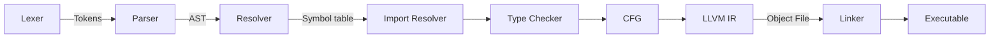

# Contributing To KrabbaScript
Since you're reading this, I want to thank you for considering contributing to KrabbaScript!

> KrabbaScript is a simple yet powerful programming language, taking inspiration from C, Lua and Python. It is compiled, statically typed and type-safe, requiring a type for every variable declaration.

Please read the [Code of Conduct](CODE_OF_CONDUCT.md) first before continuing reading this.

## AI policy
AI generated contributions are strictly forbidden unless you use AI as a tool for purely understanding the codebase.
The following examples are disallowed:

- AI generated code
- [Being a meat proxy](https://dontbeameatproxy.com/)
- Writing a commit message with AI (If you don't know English, use a translator instead of using AI)
- Writing pull requests with AI

Pull requests that meet these criteria will be closed.

## Setting up the development environment
To build and contribute to KrabbaScript, you'll need the following programs installed:

- Golang
- Git
- LLVM (not needed for now)

Start by cloning the repo
```bash
git clone https://github.com/KrabbaTek/krabbascript
cd krabbascript
```

And then build the project
```bash
go build
```

## How to actually contribute
Okay, so you got everything set up, great! This is what you can do to contribute to KrabbaScript:

### Pick an issue or suggest a feature
Pick an issue at the [GitHub issues tab](https://github.com/KrabbaTek/krabbascript/issues). I recommend you search for these tags if you are a beginner:

- `good first issue`: Perfect for beginners
- `bug`: A bit harder than good first issue, but still doable
- `help wanted`: A bug fix/feature needing the community's suggestions
- `documentation`: Documenting the code or improving the README

If there's a feature you want to add that's not in the issues, open an issue first.

## Understanding the compiler design
The compiler's pipeline is built as:


Check out [DESIGN.md](DESIGN.md) for more info.

## Workflow
1. Fork the repo
2. Create a new branch for your feature/fix with:
   ```bash
   git checkout -b feat/epic-feature
   ```
   The prefix of the branch may only be `fix` or `feat`
3. Write your changes while following Go's coding style
4. Write a test suite for the feature and run the tests with `go test -v ./...`
5. Run `go fmt ./...` in the project root
6. Write a commit message covering what you've changed, added or fixed. Example:
   ```bash
   git commit -m "Add cake-baking for the user"
   ```
7. Push your fork and create a new pull-request to `dev`. (Note: attempting to merge with main will close your PR).
   Describe the changes you have made to the codebase clearly. You can use keywords to close an issue (example `Closes #10`)
   If the CI fails on the tests, please review your code and fix it.

   Tips: You may also try out the feature or the compiler itself with a `test.ks` file.

## Want help?
Open a Q&A issue if you need any help!