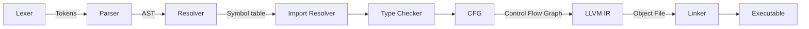
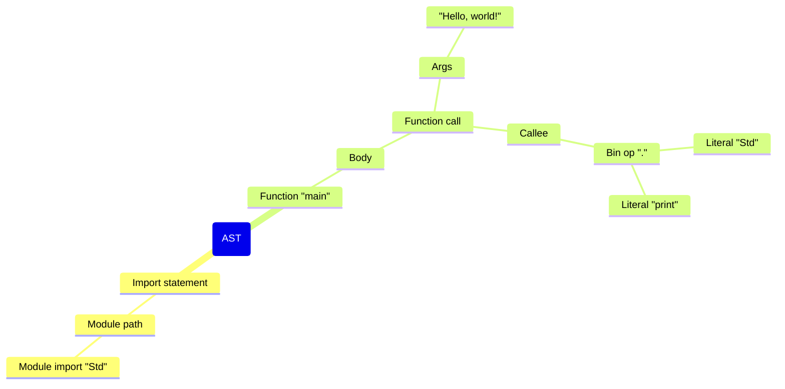
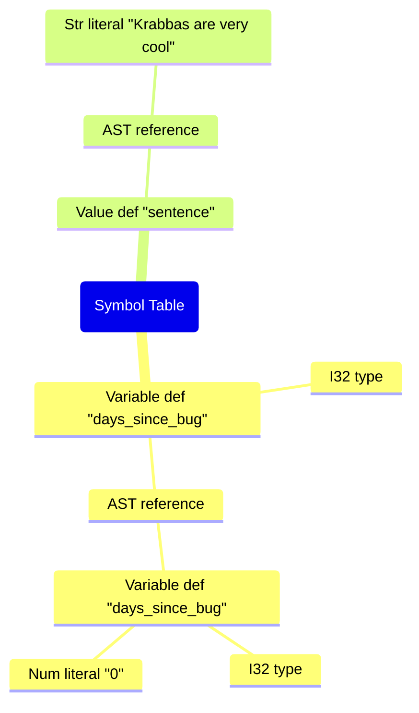
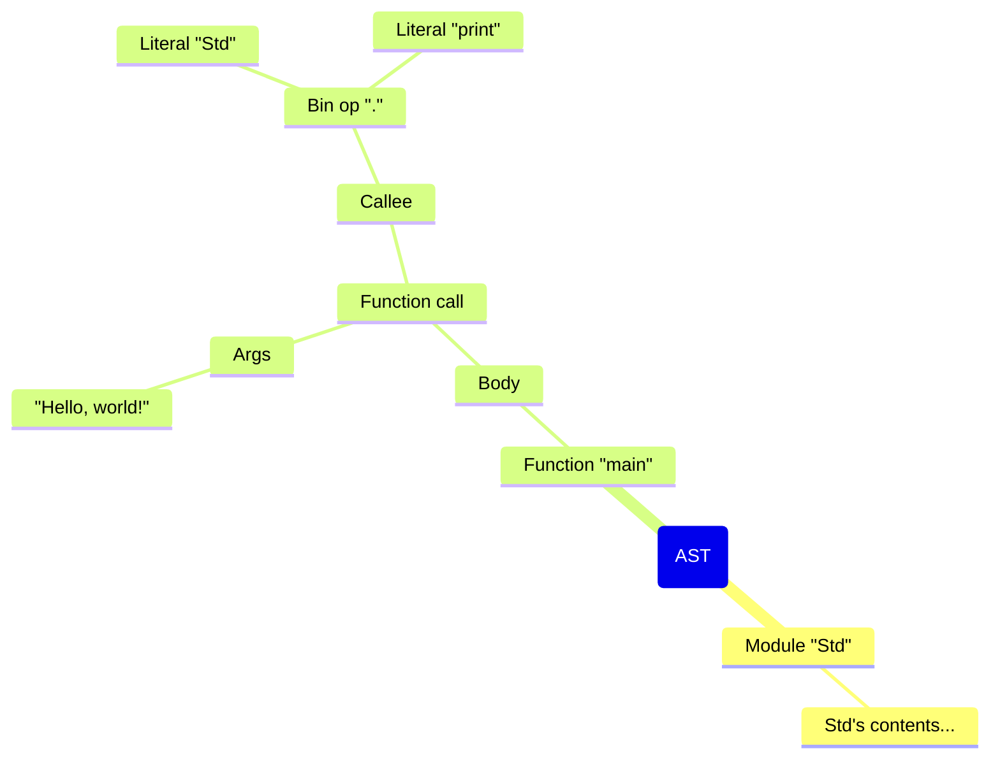
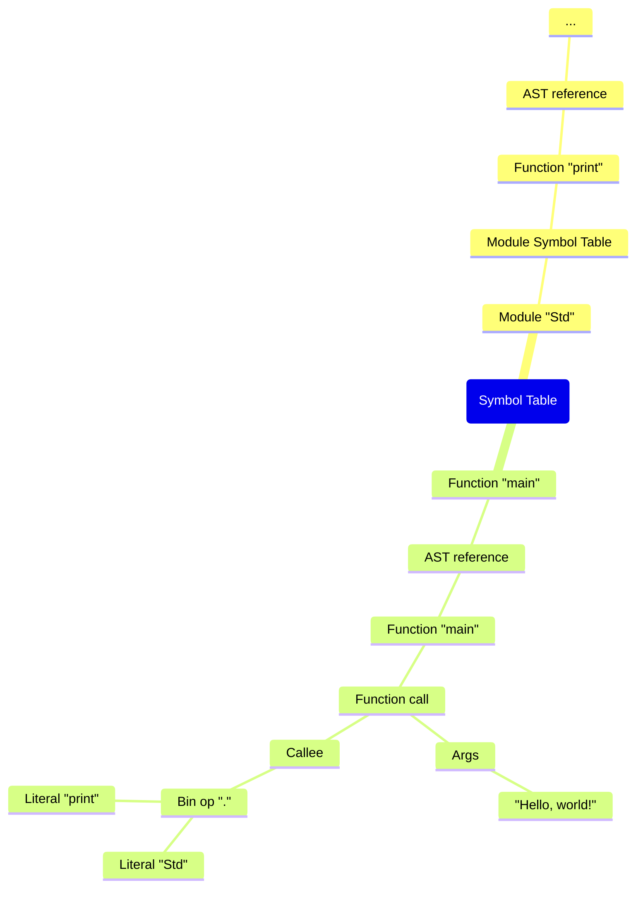

# KrabbaScript's design


_A little pipeline of the compiler_

## Lexer (AKA Tokenizer)
Lexer's job is to convert the source code into a sequence of tokens. For example the following input:
```kscript
import Std;

func main() {
    Std.print("Hello, world!");
}
```
will produce the following tokens:
```
import
literal "Std"
;
func
literal "main"
(
)
{
literal "Std"
.
literal "print"
(
str literal "Hello, world!"
)
;
}
```

```go
type Token struct {
	Type         TokenType
	Line, Column int

	Value string
}
```
KrabbaScript's token struct carries a line and column, token type and the value.
The lexer also ignores comments like `# This is a comment`

## Parser
Parser's job is to generate an [AST](https://en.wikipedia.org/wiki/Abstract_syntax_tree) which is made out of nodes, from the tokens generated from the lexer.

```go
type Node struct {
	Left  *Node
	Right *Node
	Type  NodeType

	Lexeme       string
	Line, Column int

	ExtraInfo any
}
```
This is how a node is represented in KrabbaScript. It carries a line, column, its left and right, its type, lexeme and any additional info.

```go
type NodeInfoBlock struct {
	Elements []*Node
}

type NodeInfoFunction struct {
	Args       []*Node
	ReturnType *Node
	Body       *Node
}

type NodeInfoFunctionCall struct {
	Args   []*Node
	Callee *Node
}
```

This is what the `ExtraInfo` of a node can be. Following the previous example, this is how it's represented in the AST:



> [!WARNING]
> The following sections are still WIP and may change

## Resolver
Resolver's job is to walk the AST and check for redeclarations and undeclared variables, values, etc. It outputs a symbol table. For example, say we write the following:
```kscript
var i = 0;
val i = 5;
```

Trying to compile that will give you a redeclaration error:
```
kscript: error: test.ks:2:1: redefinition of i at test.ks:1:1
compilation failed with 1 error(s)
```

Now let's try compiling the following:
```kscript
var c = a;
c++;
```

The error will be:
```
kscript: error: test.ks:1:9: undeclared literal 'a'
compilation failed with 1 error(s)
```

Let's use this code to look at the underlying Symbol Table:
```kscript
var days_since_bug: I32 = 0;
val sentence = "Krabbas are very cool";
```
The output will become:



```go
type SymTableEntry struct {
	Kind SymTableEntryType // The Kind field tells what the symbol is, a function, a variable, etc
	Type *parser.Node

	Ref *parser.Node // Reference to the node
}
```

This is how a Symbol Table entry looks like.

## Import Resolver
Import Resolver's job is to find a module specified in the import statement, check it (compile it without producing any binary) and then bring it into scope of the file.
Let's use our hello world example to look at how the Import Resolver works:
```kscript
import Std;

func main() {
    Std.print("Hello, world!");
}
```

After the Import Resolver's pass, our hello world will look like the following in text form:

```kscript
mod Std {
    # Std's contents...
}

func main() {
    Std.print("Hello, world!");
}
```

But really the Import Resolver merges the module's Symbol Table, CFG and AST etc together. It will look more like:





## Type Checker
The Type Checker's job is to, well, type check and make sure that everything has a valid type and that types are used consistently. It verifies that a value assigned to a variable matches the variable’s declared type, that operators are applied to compatible operands, that function calls pass the right number and types of arguments, and that a function’s `return` matches its declared return type. For variables without a type annotation, like `val x = 5;`, it infers the type from the initializer and fills it into the symbol table.

For example, passing the following code:
```kscript
var sentence: I32 = "Krabbas are very cool";
```

Will give you the following error:
```kscript
kscript: error: test.ks:1:15: expected `I32`, got `Str`
compilation failed with 1 error(s)
```